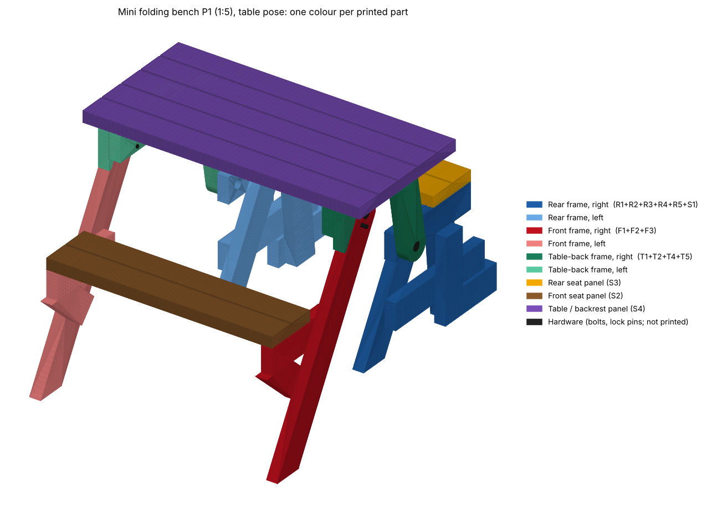
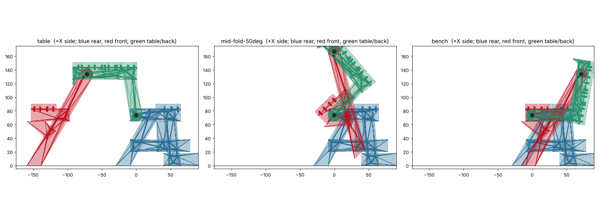

# Mini folding picnic bench P1 Rev 2 — 1:5 printable test model

A 1:5 version of the folding bench (table ⇄ bench) for printing and checking the mechanism before building
the full-size one. Generated from the same geometry as the full-size design, so every member, pivot, stop and
lock-pin position is the real one divided by 5.

**Nine printed parts.** Everything that moves together is printed as one piece: each rigid side frame is a
single fused part (the full-size laps and glue joints are gone), and each group of planks is one panel.

| Printed part | Qty | Fuses (full-size parts) | Moves with |
|---|---|---|---|
| `Rear-frame_R` / `_L` | 1 + 1 | R1 R2 R3 R4 R5 S1 | fixed (floor) |
| `Front-frame_R` / `_L` | 1 + 1 | F1 F2 F3 | swings on pivot A |
| `Table-frame_R` / `_L` | 1 + 1 | T1 T2 T4 T5 | swings on pivot B |
| `Seat-panel-rear` | 1 | S3 planks | rear frame |
| `Seat-panel-front` | 1 | S2 planks | front frame |
| `Table-panel` | 1 | S4 planks | table-back frame |

The planks are not individually connected: each panel is one solid piece with shallow grooves where the plank
gaps are. Each panel is glued onto its two side frames with 2 pegs per end.

*Table pose, one colour per printed part. Bench pose: `preview-iso-parts-bench.png` (made by `render_iso.py`).*

## Files
| | |
|---|---|
| `step/mini-bench-P1-table.step` | Full assembly, table pose (fold 0°), lock pins in |
| `step/mini-bench-P1-mid-fold-50deg.step` | Same, 50° folded, front seat in its hands-off position, pins pulled |
| `step/mini-bench-P1-bench.step` | Same, bench pose (100°), pins in |
| `stl/parts/*.stl` | The 9 printed parts, **already oriented for printing** |
| `parts.csv` | Printed size, volume and support estimate per part |
| `build_mini.py` + `folding_p1_data.json` | Generator and its source geometry |
| `render_iso.py` | The isometric picture |

## Load into Fusion
1. *File → Open → Open from my computer* (or *Insert → Insert into Current Design*) and pick a `.step` file. Units are mm.
2. It arrives as four sub-components: **Rear frame (fixed)**, **Front frame (swings on A)**,
   **Table-back frame (swings on B)**, **Hardware**. Each printed part is one body. Floor is Z = 0.
3. If it lands on its side, rotate it (Fusion is Y-up by default; the model is Z-up).
4. To play the mechanism, ground the rear frame and add two **revolute joints** (axis = X):
   * **Pivot B**: Table-back frame ↔ Rear frame, origin at Y = 0, Z = 73.5 (table pose)
   * **Pivot A**: Front frame ↔ Table-back frame, origin at Y = −71.5, Z = 133.5 (table pose)

   Joint limit on B: 0–100° (the table lowers its far edge and becomes the backrest). The front frame is only
   attached at A, so it swings freely like the real one; the app's hands-off path keeps it roughly level (0° at
   both ends, about 44° tilt at 50° fold). Fusion does not simulate contact by default, so use the three STEP
   poses to check the end positions.

## What is, and isn't, 1:5
* **Depth, height, member sections (7.6 × 17.8 mm), pivot positions and stops: exactly 1:5.** The fold geometry is
  planar, so this is what decides whether the mechanism works.
* **Width is not scaled.** True 1:5 would give 304 mm panels. The default is 190 mm overall (table panel) so
  everything fits a 220 × 220 mm bed. For true width: `python3 build_mini.py --width 304` (needs a ~310 mm bed).
* Layer gaps in X are the full-size 3 mm gaps / 5 = **0.6 mm**. The fused frames keep the stepped layers,
  because the layers are what let the three frames pass each other.
* The plank gaps on the panels are cosmetic grooves 0.8 mm deep (not through). The old 6 mm gaps are filled in.
* R3's front-top corner has the 1.2 mm radius (full-size "R6") that the front seat slides over.
* R3's bottom edge is 0.2 mm lower than the original so it overlaps S1 instead of touching it edge to edge (that
  line contact would be a non-manifold edge in the fused print). S1's top, which carries the table, is unchanged.

## Printing
* Largest parts: Table panel 190 × 94 mm; Front frame 96 × 142 mm; Rear frame 119 × 82 mm. All fit a 220 mm bed.
* **The three frames are stepped (two or three layers) and need supports**, on the build plate only. They are
  already rotated to the end that needs the least: Rear frame ≈ 26 cm², Table frame ≈ 14 cm², Front frame ≈ 10 cm²
  of overhang (`parts.csv`). Tree or organic supports are easiest. The overhangs are 7.6 mm layers over empty
  space, so they come off cleanly. Panels print flat with no supports.
* PLA/PETG, 0.4 mm nozzle, 0.16–0.2 mm layers, ≥ 3 walls, 25 %+ infill.
* Left and right frames (`_L` / `_R`) are **mirror images, not copies**; print both.
* Holes are drawn at nominal size (pivot Ø3.4, lock pin Ø2.2, pegs Ø2.0). Printed holes come out small; run a 3.5 mm
  drill through the pivot holes and check one pivot before assembling everything.
* Solid volume of all parts ≈ 400 cm³. Expect roughly 150–250 g of filament at normal infill. The table panel is
  about a third of that; print it at low infill.

## Hardware (starting spec, check what you have)
| Qty | Item | Where |
|---|---|---|
| 4 | M3 × 14 socket-head screw | Pivots A and B, one per side each; head sits in a Ø6.6 × 3.4 counterbore, flush |
| 4 | M3 nyloc nut | in the Ø6.8 × 4.4 nut counterbore on the inner face |
| 4 | M3 washer, 0.5 mm thin type | between the two moving faces at each pivot (sets the 0.6 mm gap) |
| 2 | Ø2 mm rod, ~25 mm (or 1.75 mm filament with a bent end) | lock pins: through the front frame into the table frame (table hole or bench hole) |
| 12 | 1.75 mm filament, cut ~6.5 mm | panel registration pegs (2 per panel end, per side) |
| – | Cyanoacrylate or epoxy | panels to frames only, **never on a moving face** |

Pivot tightening: snug the nyloc until the play just goes, then back off until the joint swings freely. It clamps
the faces, because there is no sleeve at this scale. A drop of thread-lock helps.

## Assembly
Nothing to glue inside a frame. Six frame halves, three panels, four pivots.
1. Glue the **rear seat panel** onto both rear frames, the **front seat panel** onto both front frames and the
   **table panel** onto both table-back frames. The pegs register them; the panel sits on top of the bearers (R3, F2, T1).
2. Fit the pivots: **B** (table-back frame ↔ rear frame) and **A** (front frame ↔ table-back frame), with the thin
   washer between the faces. The head sides are the outer faces of the table-back frame at B and the front frame at A.
3. Fold with the lock pins out; fit them at 0° (table) and at 100° (bench).

## What was checked
* Source mechanism: swept 0–100° in 0.25° steps, held-level and hands-off, over every timber pair: 0 clashes
  (reproduces the full-size validation).
* The finished mini solids (fused frames, panels, bolts and pins) swept every 5° from 0° to 100° with the real 3D
  kernel: 0 interferences.
* The lock-pin holes line up with the pin at both endpoints (0° and 100°).
* Each fused frame is a single connected solid; all 9 STL are closed, manifold solids.
* **Not** checked: the printed fit and tolerance (needs a physical print), strength, friction at the pivots, how
  well your slicer supports the stepped frames.

## Notes
* The front-seat "hands-off" motion in the 50° file is the simulated gravity path from the original design.
* `folding_p1_data.json` is the `FOLDING_P1` object extracted from `app/index.html`, because the original
  `folding-P1/rev2/` folder is not in this repository.
