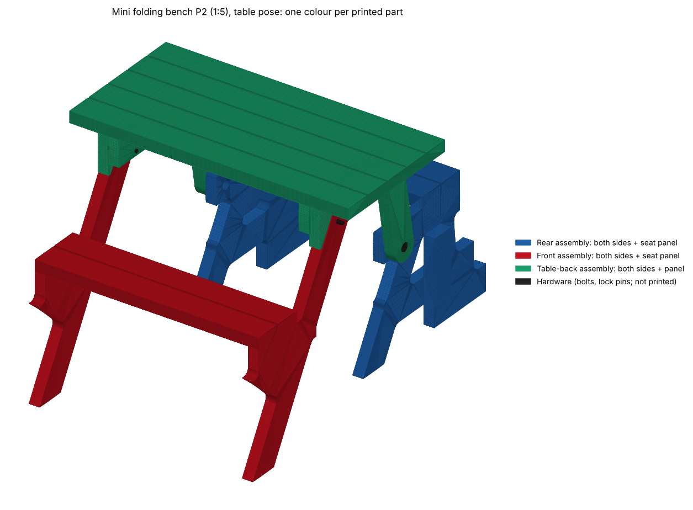

# P2: plate-built folding picnic bench (second option)

A second way to build the same convertible bench as `folding-P1` Rev 2. It folds the same way (table to bench, four pivots,
three rigid assemblies, hard stops and lock pins); what changes is the construction: **each rigid assembly side is one
plywood plate instead of a stack of 4 to 6 laminated members.** 21 pieces instead of 35.



## Is it really better? Short answer: better to build, not cheaper

Full numbers and how each was computed: [`comparison.md`](comparison.md). Both designs were put through the same checks.

| | P1 Rev 2 | P2 | |
|---|---|---|---|
| Does it fold, lock and stay stable? | yes | yes | **identical** (0 clashes 0–100°, locked at both ends, same tip-over margins) |
| Pieces in the bench | 35 | 21 | −40 % |
| Member-to-member joints | 24 | 6 | −75 % |
| Screws 5×70 / M8 bolts | 98 / 6 | 60 / 0 | −39 % / −100 % |
| Width of the side stack | 196 mm, 8 layers | 114 mm, 5 layers | −42 % |
| Weakest connection | 2 M8 bolts carry the T1/T2 moment (utilisation 0.49) | none: T1 and T2 are one plate | better |
| Bench mass | 36.3 kg | 37.8 kg | +4 % (plywood is denser) |
| Material cost estimate | 243 | 435 | **+79 %** |
| Sawing | 6 m of straight crosscuts | 18 m of outlines with curves | needs CNC, bandsaw or jigsaw + router |
| 1:5 mini print, plastic | 449 cm³ | 403 cm³ | −10 % |

**Where it wins:** far fewer pieces and glue joints, no bolted lap, nothing to align across 13 members per side, a narrower stack.
**Where it loses:** about 80 % more material cost (plywood plus 55 % waste), 3× more sawing with curves, and it needs a
plywood sheet and a way to cut accurate profiles. It also has no advantage in how it folds.
**Not better:** the stop lugs. T4's glue line is at 0.95 MPa at the 4 kN stop reaction in both designs (about 1 MPa is the
design limit), so T4 needs a through bolt in either.

## What I took from the video, and what I could not

I could not open the video (this environment blocks YouTube) and could not measure it. I worked from your three screenshots only.
* **Taken from them:** it is the same family of mechanism as P1: a long rounded-end diagonal arm that is the table's front leg and
  becomes the armrest; a rounded-end link from the table apron to a pivot at the rear seat; two seats; the table rotating up to
  become the backrest. That is exactly P1's linkage, so P2 keeps P1's proven geometry rather than inventing a new one.
* **The video's actual parts and dimensions: not known.** If its linkage or sizes differ, send dimensions or more screenshots
  and I will regenerate: everything here is driven by `p2_design.py` and the validators.
* "Fewer parts and more solid" is therefore **my** reading of how to build that bench: monolithic plates with rounded inside corners (R20), in place of laps.

## How it is built

| Per side | Piece | Material | Replaces (P1) |
|---|---|---|---|
| Rear plate `RP` | legs, seat bearer, low tie, foot in one plate | 2 × 18 mm birch ply = 36 mm | R1 R2 R3 R4 R5 |
| Table plate `TP` | apron and pivot extension in one plate | same | T1 T2 (and their bolted lap) |
| Front plate `FP` | long leg, seat bearer, brace in one plate | same | F1 F2 F3 |
| Lugs `S1` `T4` `T5` | stop blocks, glued on the plate faces | same, from offcuts | S1 T4 T5 |
| Boards | S2 ×2, S3 ×2, S4 ×5, 38 × 89 | softwood | unchanged (S2 is 12 mm and S3 4 mm shorter) |

Across the width (outer face on the right): rear plate 552–588, rear stop lug S1 588–624, table plate 591–627, table stop lugs 627–663,
front plate 630–666. Gaps of 3 mm at both pivots, so each pivot stack is 75 mm (P1: 79). The three frames pass each other only because they are in
different layers; the lugs reach into the neighbouring layer so they can bear on each other at the endpoints. See `drawing-layers.svg`.

**Why plywood, not solid panel:** a solid plate has one grain direction. The front plate has a leg at 60° and a horizontal seat
bearer, so whichever one is cross-grain is far over its tension-perpendicular limit (utilisation 12 at 3 MPa). In cross-ply birch the same member is at 0.22.
Plywood strength is a conservative design value, not tested.

**Pivots, pin, hardware:** same positions and parts as P1 (`bom.csv`): M10 bolt through a bushed sleeve, 3 mm thrust washer, lock pin Ø10 through
the front plate into the table plate. Sleeve is 50.5 mm instead of 54.5 because the stack is 75 mm.

## Files

| | |
|---|---|
| `comparison.md` | P1 vs P2, every number, how it was computed |
| `drawing-fold-sequence.svg/.png` | P2 table → bench in five poses (hands-off front seat); `-P1` version for comparison |
| `drawing-plates.svg/.png` | plate and lug profiles with hole coordinates and counterbores |
| `drawing-layers.svg/.png` | the x-layer stack, P1 against P2 |
| `drawing-plate-nesting.svg/.png` | the 24 plies nested on one 2440 × 1220 sheet |
| `profiles-mm.dxf` | outlines and holes for a CNC or laser |
| `cutting-list.csv`, `bom.csv` | cut list and hardware |
| `p2_data.json` | geometry in the same schema as `folding-P1/mini/folding_p1_data.json` |
| `validation.json` | all check results for both designs |
| `mini/` | 1:5 print set (3 parts), STEP poses (table, 50°, bench), isometric pictures |

## 1:5 mini model and Fusion

`mini/step/mini-bench-P2-{table,mid-fold-50deg,bench}.step` and `mini/stl/parts/` are built exactly like the P1 mini
(`folding-P1/mini/build_mini.py --data folding-P2/p2_data.json`): three printed parts, no glue, M3 pivots, lock pins. In Fusion, import a STEP, ground the rear
frame and add two revolute joints along X, at Y = 0, Z = 73.5 (pivot B, table frame to rear frame) and Y = −71.5, Z = 133.5 (pivot A, front frame to table frame).
The mini passes the 3D interference sweep (0 interferences, 0–100°, hardware included) and all STLs are watertight.

## What was checked, and what was not

* Fold sweep 0–100° (held level and hands-off), endpoint locking, lock-pin alignment, stop contacts, tip-over: [`comparison.md`](comparison.md).
* The hands-off solver (`handsoff.py`) was calibrated first: run on P1 it reproduces P1's own stored curve to 0.27°.
* **Not checked:** a physical build or print; plywood strength (design value assumed); glue-line strength (assumed 1 MPa); the plate cutting
  accuracy needed at the pivots; cost beyond the project's own rates (the plywood price is the sheet price in `simple-G1/project.json`).
* The app in `app/` does not include P2: its part model is convex solids only and cannot hold a plate with a cut-out.

## Rebuild

```bash
python3 p2_design.py            # p2_data.json from P1's geometry
python3 p2_validate.py          # validation.json + drawing-plate-nesting.svg   (also needs handsoff.py, kin.py, nest.py)
python3 p2_report.py            # comparison.md, cutting-list.csv, bom.csv
python3 p2_drawings.py          # drawings and DXF;  python3 svg2png.py drawing-*.svg
python3 ../folding-P1/mini/build_mini.py --data p2_data.json --out mini    # STEP + STL
```
