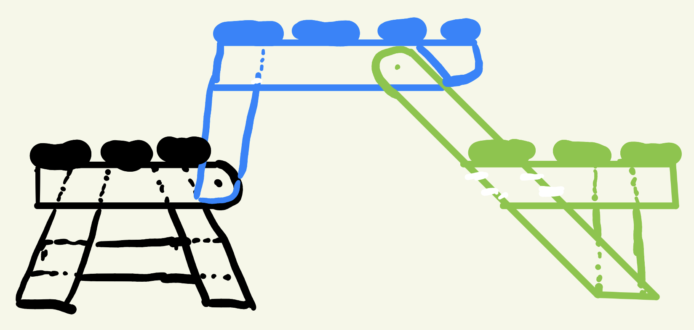

# Folding bench V2 — simple version from the video

All dimensions mm. Generated by `build.py` from the sketch in `sketch.png` (2026-10-18). In the app: **Folding picnic bench → V2 Simple**.

## The geometry

Three sub-assemblies, two pivots per side, ten frame parts per side (P1 Rev 2 has thirteen).

| Sketch colour | Assembly | Parts (per side) | Boards |
|---|---|---|---|
| black | rear seat, fixed | R1 seat rail (rounded front end = pivot **B**), R2 + R3 legs splayed 15°, R4 stretcher | 3 × S1 |
| blue | table / backrest, turns 100° about B | T1 apron, T2 strut (rounded end on B, leans 8°), T3 spread stop at the table end | 4 × S2 |
| green | front seat, hangs from **A** | F1 arm (rounded end on A, 30° from vertical, runs to the floor), F2 seat rail, F3 vertical leg | 3 × S3 |

F1 laps F2 and the foot of F3, so the front seat is a rigid triangle standing on two feet. That is what makes V2 simpler than P1: the floor sets the front seat level in both poses, so P1's bench stop T5, foot plank R5 and bearing stop S1 are not needed.

How it folds: A sits on the apron centre line, 363.5 in front of B and 305 above it, so after 100° it is back at the same height 727 further back. The front seat therefore just moves 727 rearward and lands in front of the rear seat, its boards resting on the bare front of R1.

| | |
|---|---|
| Tabletop | 1520 × 578, 755 high |
| Seats | 450 high; rear seat 98 and front seat 57 outside the table edges |
| Bench | seat 438 deep, backrest top 872 |
| Floor footprint (table) | -803 … 398 |
| Parts / mass | 30 pieces, about 41 kg |

## Where V2 departs from the sketch, and why

1. **Board widths.** The table is 4 × 38×140 and each seat is 3 × 38×68 (a 38×140 ripped in two). With 38×89 everywhere, the bench seat would be 3 + 3 boards = 570 deep, and the table would be too narrow to put A where the 100° fold lands the front seat beside the rear seat.
2. **Arm angle 30°, not ~45°.** At 45° the arm reaches the floor about 180 beyond the front seat, so the vertical leg would stand outside the seat. At 30° the arm foot and the leg are both under the seat.
3. **Rear seat boards stop 118 short of the rail end.** That bare strip is where the front seat boards land in bench pose. The rear edge is also held at 334: the table boards sweep a 349.5 radius around B while folding and would hit a board further back.
4. **F3 butts under F2.** Both are in the same layer outside the arm. Seat load goes straight down through the butt; F1 lapping both handles racking.
5. **T3 is the blue block at your table end.** Its face is cut to the arm angle and stops the arm swinging out from under the table.
6. **Lock pin kept.** One Ø10 pin per side, through F1 into a "table" or "bench" hole in T1. It stops the front seat swinging when you lift the table to fold it. Optional if you don't need that.

Pivot hardware is the same as P1 (bushed M10, 3 mm thrust washer).

## Checks run

- Planar rigid-body simulation (`kin.py`, calibrated against P1 Rev 2's recorded path to within 0.25°).
  - Held level, 0–100° in 0.25° steps, every timber pair in overlapping x-layers plus the floor: **0 clashes**.
  - Hands-off (front seat hangs from A under gravity, rides the floor): **0 jams**. It swings up to about 46° mid-fold and comes down on both feet at each end.
- With the pin in: table pose, unfolding is blocked by the floor; bench pose, both directions are blocked by the floor.
- The app's own clash check: 0 interferences every 2° from 0 to 100°, both motion modes, with and without fasteners.
- Fasteners: spacing, ≥ 9 mm edge distance, clear of pivot B and the pin holes. Board spans: seat span/1199, table span/838 at 2 kPa.
- `project.json` loads with no adjustments. P1 renders exactly as before.

## Not done / needs a prototype

- **Not load-rated.** No strength calculation of the laps, the strut-to-apron bolts or T3 under people leaning on the table. Proof-load a prototype.
- Rear tip stability (person leaning on the backrest) was judged from the footprint only: the rear foot is at 398.
- The hands-off swing (up to 46°) is what gravity alone does. In practice you will steady the front seat by hand while folding.

## Cut list (38 thick)

| Part | Qty | Stock | Blank length | Marking-out outline (length, width), mm |
|---|---|---|---|---|
| R1 Rear seat rail | 2 | 38 × 89 | 380 | one end rounded R44.5 on the pivot; see drawing |
| R2 Rear frame front leg | 2 | 38 × 89 | 451 | (450.381, 0) → (426.534, 89) → (0, 89) → (23.848, 0) |
| R3 Rear frame back leg | 2 | 38 × 89 | 451 | (23.848, 89) → (0, 0) → (426.534, 0) → (450.381, 89) |
| R4 Rear frame stretcher | 2 | 38 × 89 | 350 | (0, 89) → (0, 0) → (350, 0) → (350, 89) |
| S1 Rear seat board | 3 | 38 × 68 | 1180 | rectangle 1180 × 68 |
| T1 Table apron / backrest post | 2 | 38 × 89 | 578 | (0, 89) → (0, 0) → (578, 0) → (578, 89) |
| T2 Strut | 2 | 38 × 89 | 404 | one end rounded R44.5 on the pivot; see drawing |
| T3 Table spread stop | 2 | 38 × 89 | 169 | (0, 0) → (168.823, 0) → (168.823, 89) → (51.384, 89) |
| S2 Table / backrest board | 4 | 38 × 140 | 1520 | rectangle 1520 × 140 |
| F1 Arm (table leg) | 2 | 38 × 89 | 847 | one end rounded R44.5 on the pivot; see drawing |
| F2 Front seat rail | 2 | 38 × 89 | 361 | (0, 89) → (0, 0) → (360.97, 0) → (360.97, 89) |
| F3 Front seat leg | 2 | 38 × 89 | 323 | (0, 0) → (323, 0) → (323, 89) → (0, 89) |
| S3 Front seat board | 3 | 38 × 68 | 1496 | rectangle 1496 × 68 |

Buying: seven 38×140 × 2400 (four table boards, three ripped for the six seat boards) and four 38×89 × 2400. See `cutting-plan.txt`.

## Files

| File | What |
|---|---|
| `build.py`, `kin.py` | Generator + kinematics. `python3 build.py`, then `python3 ../app/make_app.py` |
| `export.py`, `report.py` | Regenerate the exports below / `poses.svg` and `cutlist.md` |
| `project.json` | App design file (variant V2) |
| `parts.json`, `schedule.csv`, `hardware.csv`, `cutting-plan.txt`, `freecad.py` | App exports |
| `drawing-table.svg`, `drawing-bench.svg` | App drawings, table and bench pose |
| `poses.svg` | Side view at 0°, 35°, 70°, 100° (hands-off) |
| `validation.json` | Sweep results, hands-off path, lap areas |
